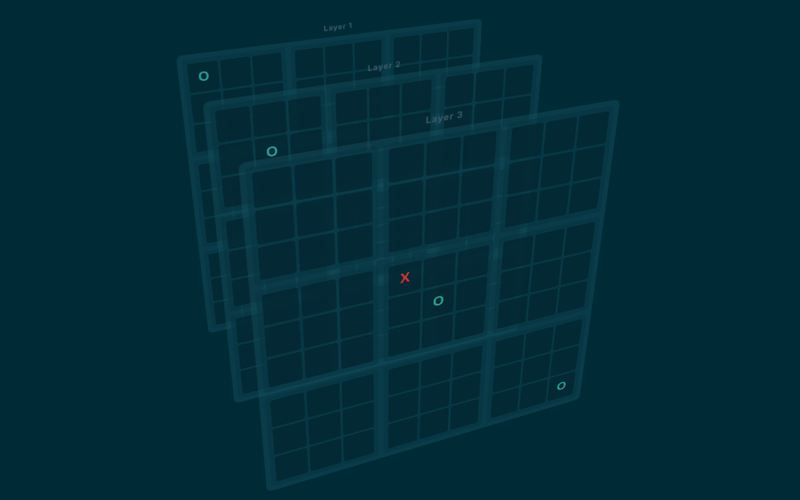
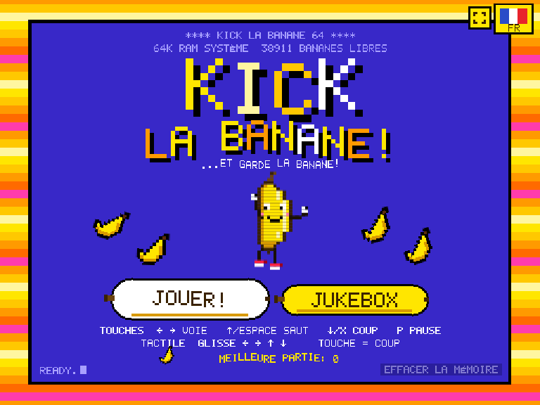
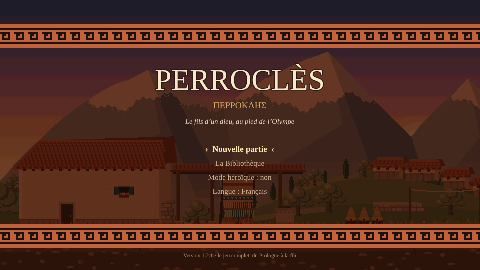
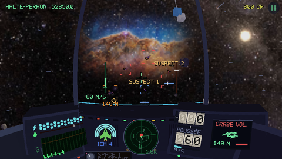
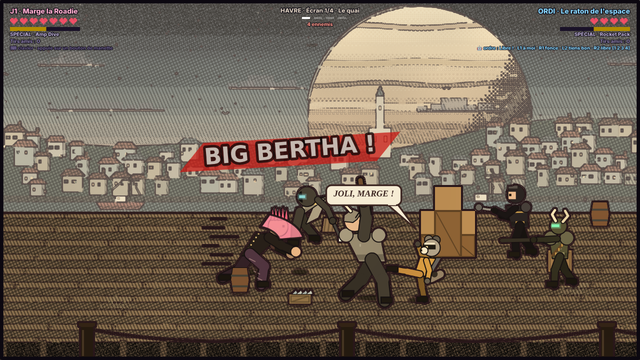

# Les Productions Maison Perron 

*Des petits jeux rétro, faits à la maison.* Small retro games, made at home.

This is the home of the Perron family's browser games. Each game is **one self-contained HTML
file**: download it, double-click it, play. No install, no build step, no server, no account.
They run on a computer, a phone or an iPad, and most of them speak French first.

**▶ Play online: [u269c.github.io/Maison-Perron](https://u269c.github.io/Maison-Perron/)**

> **En bref :** chaque jeu est un seul fichier HTML qu'on ouvre dans un navigateur, et c'est
> tout. Les jeux sont en français par défaut, avec l'anglais à un clic (le drapeau à l'écran
> titre).

## The games

| | Game | What it is | Plays with | Languages |
|---|---|---|---|---|
|  | **[Tic-Tac-Toe³](games/tic-tac-toe-3)**<br>▶ [`tic-tac-toe-3.html`](games/tic-tac-toe-3/tic-tac-toe-3.html) | Tic-tac-toe, cubed: 27 small boards stacked into a 3 × 3 × 3 cube. Win small boards to claim their squares, then line up three of them along any of 49 lines. Three rules for drawn boards, tournaments, and saving a game as a link. | Mouse, 2 players on one screen | English |
|  | **[BlocSauteur](games/blocsauteur)**<br>▶ [`blocsauteur.html`](games/blocsauteur/blocsauteur.html) | 8-bit side-scrolling platformer. Six worlds, boss arenas, a parachuting merchant, a pickleball challenger and a maze finale against your own shadow. | Keyboard, touch, gamepad | English |
|  | **[Kick la Banane !](games/kick-la-banane)**<br>▶ [`kick-la-banane.html`](games/kick-la-banane/kick-la-banane.html) | Commodore 64-style corridor runner. You're a banana with legs, kicking blocks through seven worlds. Everything dances to a Latin soundtrack. | Keyboard, touch | FR · EN · JA · IT |
|  | **[La Mort aux Trousses !](games/mort-aux-trousses)** *(Reaper Run)*<br>▶ [`index.html`](games/mort-aux-trousses/index.html) | One-button runner: tap to hop, hold to jump higher. Five levels with branching routes, a duel with Satan, and an endless mode. | Touch, keyboard | FR · EN |
|  | **[Mine-Moule](games/mine-moule)**<br>▶ [`mine-moule.html`](games/mine-moule/mine-moule.html) | Side-scrolling survival platformer: scavenge by day, build and cook at home, survive nights full of monsters. 62 story quests across four lands, or pure survival for a high score. Math stones at the player's grade. | Keyboard, touch, gamepad | FR · EN |
|  | **[Perroclès](games/perrocles)**<br>▶ [`perrocles.html`](games/perrocles/perrocles.html) | Greek-myth action adventure. A young demigod retraces the Labours of Heracles and the Odyssey to find out which god is his father. Two worlds on top of each other: pixel art for mortals, and a God's view painted like a black-figure vase. Prologue to the end, with a design write-up. | Keyboard, gamepad | FR · ΕΛ · EN |
|  | **[Patrouille Kepler](games/patrouille-kepler)** *(Kepler Patrol)*<br>▶ [`patrouille-kepler.html`](games/patrouille-kepler/patrouille-kepler.html) | 3D cockpit space shooter for a tablet and a PlayStation controller. Three careers (smuggler, space police, salvager) around the real Kepler-90 system, G-forces computed from the ship's motion, a four-station radio, and an arcade mode. | Gamepad only | FR · EN |

Each game's folder has its own README with the rules, the controls and how it's put together.

### How to play one

1. Open the game's `.html` file in any modern browser (Chrome, Safari, Firefox, Edge). It works
   straight from your disk.
2. On a phone or tablet, use **Add to Home Screen** for a full-screen, app-like experience.
3. Progress, unlocks and settings are saved in your browser's local storage, on your device
   only. Nothing is sent anywhere.

## Active development · playable

Games still being built. They are playable (online too, updated with every push), but expect rough edges and big changes from one week to the next.

| | Game | What it is | Plays with | Languages |
|---|---|---|---|---|
|  | **[Battle Planet ZenzizenziX](games/battle-planet-zenzizenzix)**<br>▶ [`battle-planet-zenzizenzix.html`](games/battle-planet-zenzizenzix/battle-planet-zenzizenzix.html) · [play online](https://u269c.github.io/Maison-Perron/games/battle-planet-zenzizenzix/battle-planet-zenzizenzix.html) | Two-player co-op brawler in a comic-book print look, each planet in its own print style. Twelve retired warriors, a story whose dialogue changes with every pair and every game, triple combos with named finishers, breakables to throw or charge into, status effects, friendly fire on. Solo, the computer plays your partner and takes orders. Four worlds of eight are playable: Havre, De Soif (the barman Oscar GrosVerres), Bouldaire (the hairdresser Calve-Hair, then the chase up the cranes after Madame Metal Face) and Zombimare (the marsh, the cemetery and the church of Prêtre-o-Dame). | Gamepads, keyboard; 1–2 players | FR · EN |

## What's in this repository

```
Maison-Perron/
├── README.md                 you are here
├── LICENSE                   Apache 2.0, for everything in the repo
├── index.html                the launcher: a magazine spread (contents, a page per game) and a three-question test
├── fiches.html               the same launcher as player cards (night edition), to compare
├── docs/RELEASE-FORMATS.md   how new games ship: one file that is also a PDF book, an MP3 soundtrack and a PNG poster
├── tools/stamp-launcher.py   refreshes the version / last-update line on each launcher card
└── games/
    ├── blocsauteur/          blocsauteur.html, concept art, screenshot, Playwright tests
    ├── kick-la-banane/       kick-la-banane.html, docs/DESIGN.md, screenshots
    ├── mort-aux-trousses/    index.html (the game), docs/DESIGN.md, screenshots
    ├── battle-planet-zenzizenzix/  work in progress: battle-planet-zenzizenzix.html, src/ (modules + build.py), mocks/, docs/PLAN.md
    ├── mine-moule/           mine-moule.html, music demo, docs/ (design plan, playtest report)
    ├── perrocles/            perrocles.html, source/ (modules + build.py), tools/sim (playtest bots), docs/DESIGN.md
    ├── patrouille-kepler/    patrouille-kepler.html, README, screenshots
    └── tic-tac-toe-3/        tic-tac-toe-3.html, README, screenshots
```

The games themselves are exactly as they were in their own repositories. Nothing has been
refactored yet (see [What's next](#whats-next)); only a few screenshots and READMEs were added.

## The house style

These games weren't designed as a set, but they ended up sharing a way of doing things. This
is what makes a Maison Perron game:

- **One file, no dependencies.** HTML, CSS, JavaScript, art and music all live in the same
  file. No images, no sound files, no libraries, no build. (Mine-Moule's two web fonts are the
  current exception; the game still plays without them.)
  Perroclès is written as separate modules for convenience, and a 20-line script pastes them
  into its single file; the file you play needs nothing else.
- **Everything is drawn and composed in code.** Sprites, backgrounds and fonts are painted on
  a `<canvas>`, and the music and sound effects are synthesized live with the Web Audio API.
- **Retro and pixel-crisp.** Each game draws at a small fixed resolution and scales up to the
  screen without smoothing. (Tic-Tac-Toe³ is the exception: a clean board-game look in 3D CSS,
  made for a mouse.)
- **Phones first, but everywhere.** Touch controls, safe-area insets for notches, home-screen
  support, plus keyboard, and gamepads where it fits.
- **French by default, English one tap away**, with the flag button drawn in code.
- **Platformer feel done properly:** coyote time, jump buffering, and hold-to-jump-higher.
- **A familiar flow:** title → level intro → play → level clear → merchant/shop → victory or
  game over, with levels described as data tables and a big finale (boss, remix level or duel).
- **Saves that never crash the game:** local storage behind `try/catch`, with sensible
  defaults.
- **One file, four things (new games, from Nov 2026).** The game's single HTML file is also its book (`.pdf`: the story,
  how to play, how it was made), its soundtrack (`.mp3`) and its hand-painted 1980s movie poster (`.png`): rename it and
  it becomes the other thing. See [docs/RELEASE-FORMATS.md](docs/RELEASE-FORMATS.md).
- **A hook for tinkering:** several games expose their state on `window` (for example
  `window.BS`, `window.KLB`) so you can poke at them from the browser console. BlocSauteur's
  test suite uses it.

### The music engine

The soundtracks share one engine that has grown with each game:

1. **BlocSauteur** introduced it: songs are data (`{ bpm, layers }`), and each layer is a list of
   notes or drum hits.
2. **Kick la Banane** made it schedule just ahead of time, added a grid notation for writing bars
   (`g8('C5 . E5 - | …')`), a chord book, 20 Latin percussion voices, echo, chorus and stereo,
   and a beat clock so the whole screen dances in time.
3. **Mine-Moule** added synthesized instruments (guitars with distortion, brass, strings, bells),
   crossfades, playlists, and a song generator that arranges each of its 20 songs per season and
   for day or night.

### Adding a game to the launcher

1. In `index.html`, add an entry at the end of `GAMES` (or move it there from `SOON`, the games in the
   works): its file, screenshot, French and English texts, and its four stats (1–5).
2. Add a matching `<div class="stamp" data-file="games/<name>/<file>.html"></div>` inside
   `#stamps` (in `fiches.html` too, which has its own copy of the catalogue), then run `python3 tools/stamp-launcher.py` to fill in its version and date.

`GAMES` is in age order, oldest first, and that sets each game's number (01 = the oldest). The contents list them newest first, with the games in the works below, and the launcher opens on the newest game; `index.html#mine-moule` opens a given one. Each entry's `input` list (`keyboard`, `gamepad`, `gamepad2`, `tablet`, `phone`, `mouse`) draws the small icons under its name.

## History

The first four games used to live in their own repositories and were moved here **with their full git
history**. Their files now sit under `games/<name>/`, and `git log --follow` shows each file's
history from its very first commit.

| Game | Former repository | Commits brought over |
|---|---|---|
| BlocSauteur | [u269c/BlocSauteur](https://github.com/u269c/BlocSauteur) | 95 |
| Kick la Banane | [u269c/kick-la-banane](https://github.com/u269c/kick-la-banane) | 2 |
| La Mort aux Trousses | [u269c/mort-aux-trousses](https://github.com/u269c/mort-aux-trousses) | 2 |
| Mine-Moule | [u269c/mine-moule](https://github.com/u269c/mine-moule) | 25 (v0.8 → v1.16.0) |

Tic-Tac-Toe³ is the oldest game of the lot, but it never had a repository of its own: it came straight here.

```sh
git log --oneline -- games/blocsauteur          # one game's history
git log --follow -- games/kick-la-banane/kick-la-banane.html
```

## What's next

- **A shared framework**, later. The plan is to pull the common pieces (the music engine,
  screen scaling, input, saves, translations, the main loop) into reusable code without
  giving up the one-file rule. Each game would still ship as a single HTML file.
- **New games in the works** (also on the launcher, under *En préparation*):
  - a **snow-plow company sim**: start by clearing one small town's streets, grow into fleets
    across the country;
  - **[Battle Planet ZenzizenziX](games/battle-planet-zenzizenzix)**: a two-player co-op brawler
    in the spirit of Battletoads. Two retired warriors chase the evil Lord Villen-Hüüs across
    eight planets, then fight their way home through a reversed hard mode. See its
    [plan](games/battle-planet-zenzizenzix/docs/PLAN.md);
  - **The Great Knitting Battle Royal**: competitive knitting. Knit patterns in continental or
    English style, from scarves to socks, then a two-controller design-off on a grid where the
    winner best meets the brief (say, a shirt with more than 77 and fewer than 85 triangles
    across its width).

## Contributing

Contributions are welcome: bug reports, fixes, songs, translations, ideas. This is a family
hobby project, though, so replies may be slow or may not come at all. Each game's folder has a
`CONTRIBUTING.md` (or a section in its README) with how to test a change. The one rule that
applies everywhere: **keep each game a single self-contained HTML file.**

## License

[Apache License 2.0](LICENSE). Design and direction by Francis Perron
([@u269c](https://github.com/u269c)).
