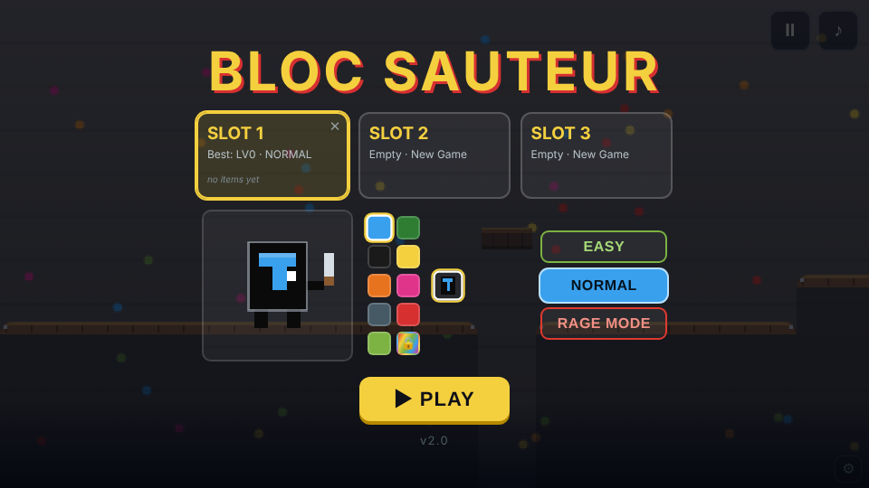
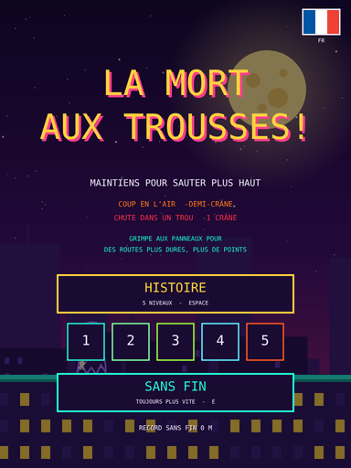
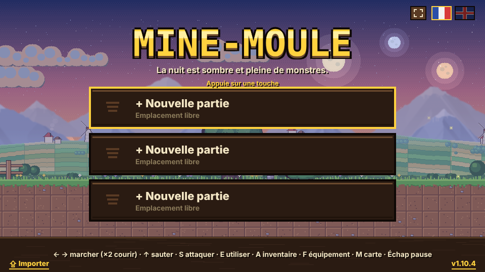

# Maison Perron Production

*Des petits jeux rétro, faits à la maison.* Small retro games, made at home.

This is the home of the Perron family's browser games. Each game is **one self-contained HTML
file**: download it, double-click it, play. No install, no build step, no server, no account.
They run on a computer, a phone or an iPad, and most of them speak French first.

**▶ Play online: [u269c.github.io/Maison-Perron](https://u269c.github.io/Maison-Perron/)**

> **En bref :** chaque jeu est un seul fichier HTML qu'on ouvre dans un navigateur, et c'est
> tout. Les jeux sont en français par défaut, avec l'anglais à un clic (le drapeau à l'écran
> titre).

## The games

| | Game | What it is | Plays with | Languages |
|---|---|---|---|---|
|  | **[BlocSauteur](games/blocsauteur)**<br>▶ [`blocsauteur.html`](games/blocsauteur/blocsauteur.html) | 8-bit side-scrolling platformer. Six worlds, boss arenas, a parachuting merchant, a pickleball challenger and a maze finale against your own shadow. | Keyboard, touch, gamepad | English |
|  | **[Kick la Banane !](games/kick-la-banane)**<br>▶ [`kick-la-banane.html`](games/kick-la-banane/kick-la-banane.html) | Commodore 64-style corridor runner. You're a banana with legs, kicking blocks through seven worlds. Everything dances to a Latin soundtrack. | Keyboard, touch | FR · EN · JA · IT |
|  | **[La Mort aux Trousses !](games/mort-aux-trousses)** *(Reaper Run)*<br>▶ [`index.html`](games/mort-aux-trousses/index.html) | One-button runner: tap to hop, hold to jump higher. Five levels with branching routes, a duel with Satan, and an endless mode. | Touch, keyboard | FR · EN |
|  | **[Mine-Moule](games/mine-moule)**<br>▶ [`mine-moule.html`](games/mine-moule/mine-moule.html) | Side-scrolling survival platformer: scavenge by day, build and cook at home, survive nights full of monsters. 62 story quests across four lands, or pure survival for a high score. Math stones at the player's grade. | Keyboard, touch, gamepad | FR · EN |

Each game's folder has its own README with the rules, the controls and how it's put together.

### How to play one

1. Open the game's `.html` file in any modern browser (Chrome, Safari, Firefox, Edge). It works
   straight from your disk.
2. On a phone or tablet, use **Add to Home Screen** for a full-screen, app-like experience.
3. Progress, unlocks and settings are saved in your browser's local storage, on your device
   only. Nothing is sent anywhere.

## What's in this repository

```
Maison-Perron/
├── README.md                 you are here
├── LICENSE                   Apache 2.0, for everything in the repo
├── index.html                a small launcher page that links to every game
├── tools/stamp-launcher.py   refreshes the version / last-update line on each launcher card
└── games/
    ├── blocsauteur/          blocsauteur.html, concept art, screenshot, Playwright tests
    ├── kick-la-banane/       kick-la-banane.html, docs/DESIGN.md, screenshots
    ├── mort-aux-trousses/    index.html (the game), docs/DESIGN.md, screenshots
    └── mine-moule/           mine-moule.html, music demo, docs/ (design plan, playtest report)
```

The games themselves are exactly as they were in their own repositories. Nothing has been
refactored yet (see [What's next](#whats-next)); only a few screenshots and READMEs were added.

## The house style

These games weren't designed as a set, but they ended up sharing a way of doing things. This
is what makes a Maison Perron game:

- **One file, no dependencies.** HTML, CSS, JavaScript, art and music all live in the same
  file. No images, no sound files, no libraries, no build. (Mine-Moule's two web fonts are the
  current exception; the game still plays without them.)
- **Everything is drawn and composed in code.** Sprites, backgrounds and fonts are painted on
  a `<canvas>`, and the music and sound effects are synthesized live with the Web Audio API.
- **Retro and pixel-crisp.** Each game draws at a small fixed resolution and scales up to the
  screen without smoothing.
- **Phones first, but everywhere.** Touch controls, safe-area insets for notches, home-screen
  support, plus keyboard, and gamepads where it fits.
- **French by default, English one tap away**, with the flag button drawn in code.
- **Platformer feel done properly:** coyote time, jump buffering, and hold-to-jump-higher.
- **A familiar flow:** title → level intro → play → level clear → merchant/shop → victory or
  game over, with levels described as data tables and a big finale (boss, remix level or duel).
- **Saves that never crash the game:** local storage behind `try/catch`, with sensible
  defaults.
- **A hook for tinkering:** several games expose their state on `window` (for example
  `window.BS`, `window.KLB`) so you can poke at them from the browser console. BlocSauteur's
  test suite uses it.

### The music engine

The soundtracks share one engine that has grown with each game:

1. **BlocSauteur** introduced it: songs are data (`{ bpm, layers }`), and each layer is a list of
   notes or drum hits.
2. **Kick la Banane** made it schedule just ahead of time, added a grid notation for writing bars
   (`g8('C5 . E5 - | …')`), a chord book, 20 Latin percussion voices, echo, chorus and stereo,
   and a beat clock so the whole screen dances in time.
3. **Mine-Moule** added synthesized instruments (guitars with distortion, brass, strings, bells),
   crossfades, playlists, and a song generator that arranges each of its 20 songs per season and
   for day or night.

## History

All four games used to live in their own repositories and were moved here **with their full git
history**. Their files now sit under `games/<name>/`, and `git log --follow` shows each file's
history from its very first commit.

| Game | Former repository | Commits brought over |
|---|---|---|
| BlocSauteur | [u269c/BlocSauteur](https://github.com/u269c/BlocSauteur) | 95 |
| Kick la Banane | [u269c/kick-la-banane](https://github.com/u269c/kick-la-banane) | 2 |
| La Mort aux Trousses | [u269c/mort-aux-trousses](https://github.com/u269c/mort-aux-trousses) | 2 |
| Mine-Moule | [u269c/mine-moule](https://github.com/u269c/mine-moule) | 22 (v0.8 → v1.15.0) |

```sh
git log --oneline -- games/blocsauteur          # one game's history
git log --follow -- games/kick-la-banane/kick-la-banane.html
```

## What's next

- **A shared framework**, later. The plan is to pull the common pieces (the music engine,
  screen scaling, input, saves, translations, the main loop) into reusable code without
  giving up the one-file rule. Each game would still ship as a single HTML file.
- **New games in the works:**
  - a **snow-plow company sim**: start by clearing one small town's streets, grow into fleets
    across the country;
  - a **two-player co-op brawler** in the spirit of Battletoads and Contra: screen-by-screen
    fights, challenge stages, a boss at the end, for two players on two controllers.

## Contributing

Contributions are welcome: bug reports, fixes, songs, translations, ideas. This is a family
hobby project, though, so replies may be slow or may not come at all. Each game's folder has a
`CONTRIBUTING.md` (or a section in its README) with how to test a change. The one rule that
applies everywhere: **keep each game a single self-contained HTML file.**

## License

[Apache License 2.0](LICENSE). Design and direction by Francis Perron
([@u269c](https://github.com/u269c)).
