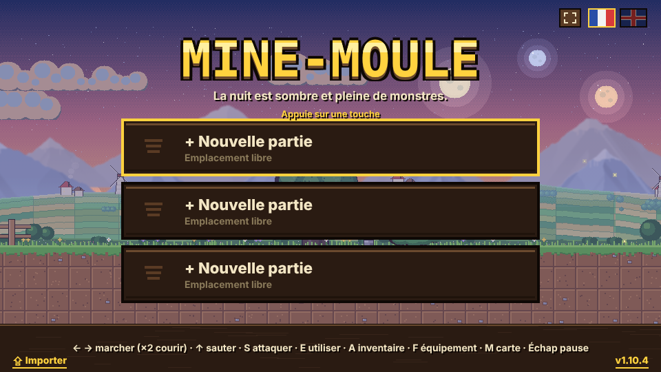

# Mine-Moule

*La nuit est sombre et pleine de monstres.*

A retro 2D side-scrolling **survival game** in a single HTML file. Gather, build, cook and
craft by day; hold out against the monsters at night. Your score is how many hours you survive.

  

## Play it

Open **`mine-moule.html`** in a browser, on a computer, phone or tablet. There's no build
step and nothing to install.

- **Languages:** French by default, with English one tap away (flags in the top-right corner
  of the title screen). The title stays *Mine-Moule* in both.
- **New game:** pick a character name, a world (*La Vallée*, *La Crique*, *Les Collines*),
  how long the seasons last (7, 14 or 28 days), **Story** or **Survival** mode, and a
  **math level** (1–6) for the riddle stones you'll find along the way.
- **Saves:** three slots in the browser's local storage. Use **Importer** on the title screen and
  the export option in the pause menu to move a save between devices as a `.json` file.

### Controls

| Action | Keyboard | Gamepad (standard mapping) |
|---|---|---|
| Walk (tap twice to run) | ← → | Left stick / D-pad |
| Jump | ↑ | ✕ |
| Attack | S | R1 / R2 |
| Use / interact | E | □ |
| Inventory | A | ○ |
| Equipment | F | △ |
| Map | M | L1 / touchpad |
| Pause | Esc | Options |

On phones and tablets, on-screen buttons appear automatically.

## Music

The soundtrack uses the music engine passed down from [BlocSauteur](../blocsauteur) and
[Kick la Banane](../kick-la-banane). It adds synthesized instruments (xylophone, bell, flute, violin, brass,
distorted guitars, bass) and a song generator. Each of the **20 songs** is a short description
(key, tempo, chords, two melodies) that the engine arranges into a full track, differently for
each season, as a ballad by day and as metal by night.

## Notes

- Mine-Moule loads two web fonts (Nunito and Pixelify Sans) from Google Fonts. Offline, it
  still plays, but falls back to system fonts.
- Add `?debug` to the URL for developer helpers.
- The in-game **NOUVEAUTÉS / WHAT'S NEW** window (title screen) is the changelog.

## History

Mine-Moule was the last of the four games to land in git: it was imported into this
repository at v1.10.4 from its published copy.
