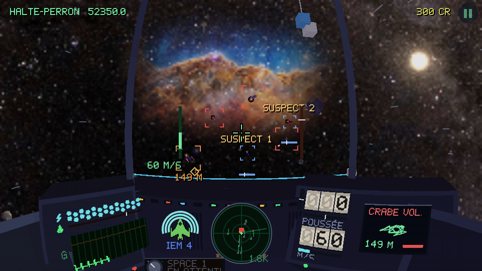
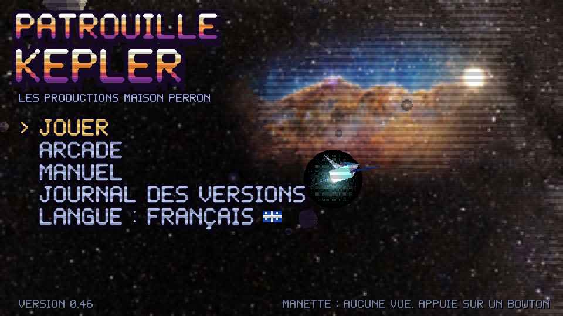
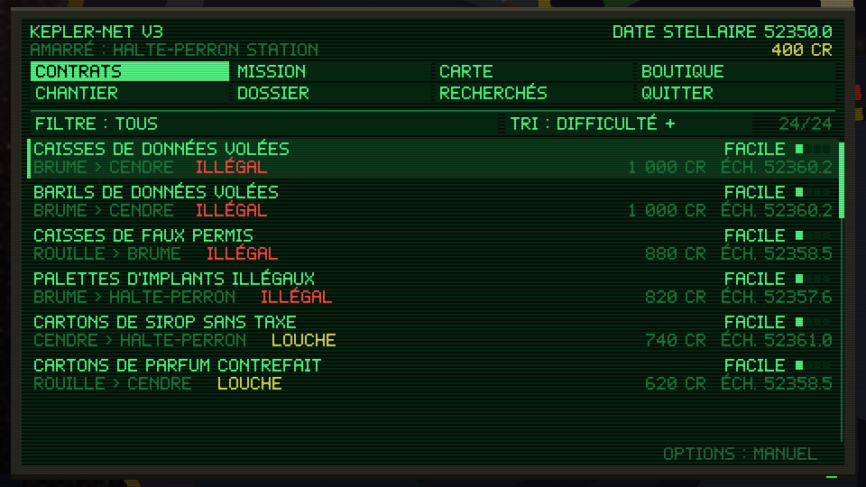
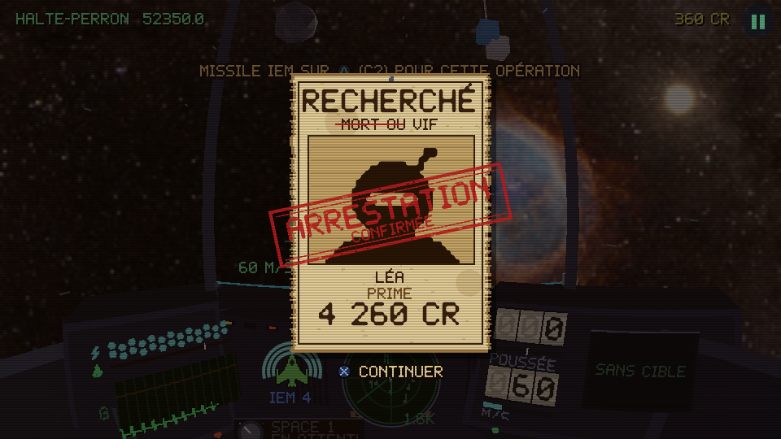

# Patrouille Kepler

A retro 3D cockpit space shooter in a single HTML file, made to be flown with a PlayStation controller (controller only), on a tablet or a computer. In English.

You sit in the cockpit of a small ship around Kepler-90, a real eight-planet system. Pick a career and work your way up: run contracts as a **smuggler**, chase pirates as **space police**, or pick wrecks clean as a **salvager**. **Arcade** mode is the endless shooter, waves and a high score.

## Play

Open `patrouille-kepler.html` in Chrome. No build step, no install. Saves live in the browser, in three pilot slots.

| Action | Controller |
|---|---|
| Pitch and turn | left stick |
| Roll | L1 / R1 |
| Thrust / brake and reverse | L2 / R2 (swappable) |
| Side thrusters, or free look (R3 toggles) | right stick |
| Fire / missile | ✕ / ○ |
| Cockpit switches (time keeps running) | touchpad or Share |
| Two custom switch buttons | □ / △ |
| Radio: station, next song | D-pad ← → / ↓ |
| Pause, options, manual | Options |

The game is played with a controller. The manual (title screen or pause) explains every gauge, career and system, with a "game vs reality" chapter and a "learning about space" chapter.

## Features

- A software-rendered 3D cockpit: a domed canopy view, gauges that sit in the dashboard and follow your head, G-forces computed from the ship's real motion, with grey-out, red-out and blackout
- Three careers, six ranks each, with promotions, bonuses and a rank-gated shop of 95 weapons, ships, energy cells and upgrades
- Smuggler: contracts won at auction against named rivals who hold grudges, sector lords whose passes you earn with favours, police heat
- Space police: patrols and arrests (weaken a suspect, then EMP them), a ten most wanted list, an old-west wanted poster stamped ARREST CONFIRMED on every capture
- Salvager: wreck sites, drones that cut parts loose, an identify-and-sell market, rival scavengers
- My File: archives (posters, bills of lading, auction lots), the lords' permits, and what each rank brings: badges and medals, hats or jackets
- G resistance: hold the load in the red without passing out and the pilot trains (levels on a Fibonacci curve), or pay for a centrifuge session
- A dashboard radio: four stations of twenty songs each, composed in the browser (outrun, cosmic techno, jazz fusion, and public-domain classics)
- UV and infrared vision, a performance graphics mode, a CRT filter, controller rumble

## Screens

| | |
|---|---|
|  |  |
|  |  |
