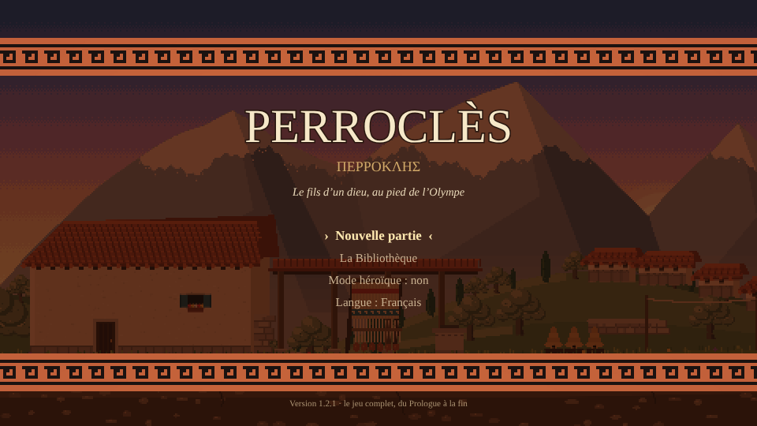
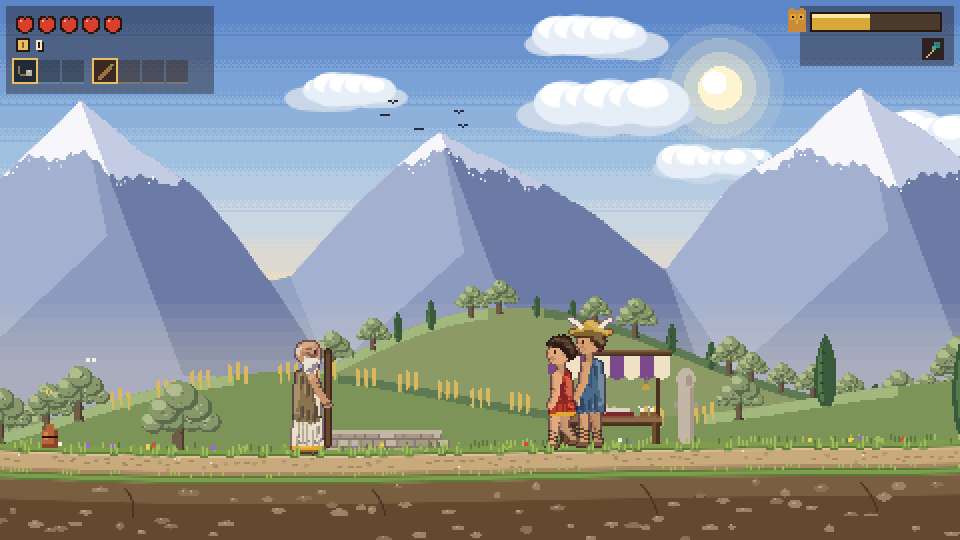
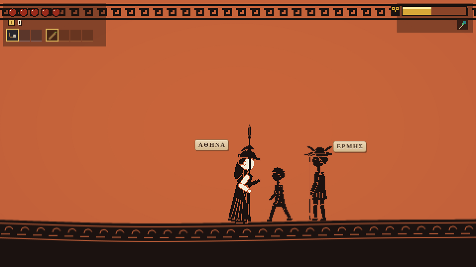
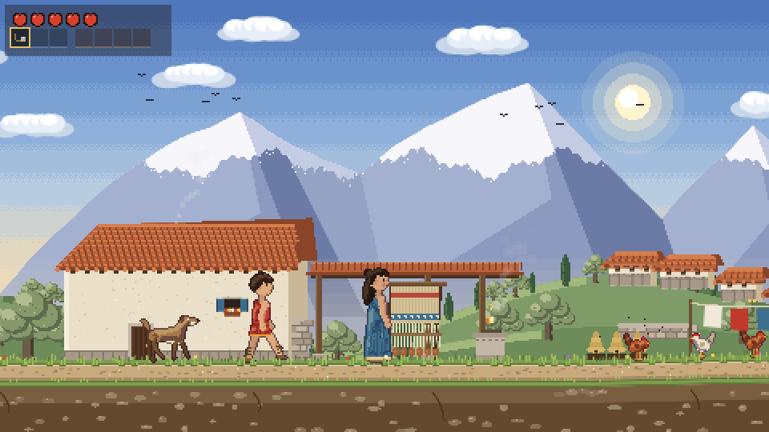
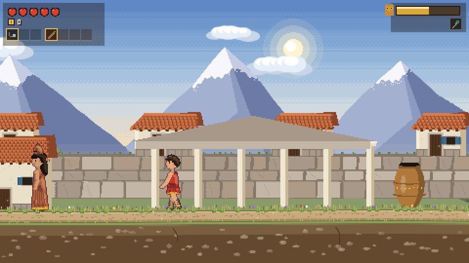
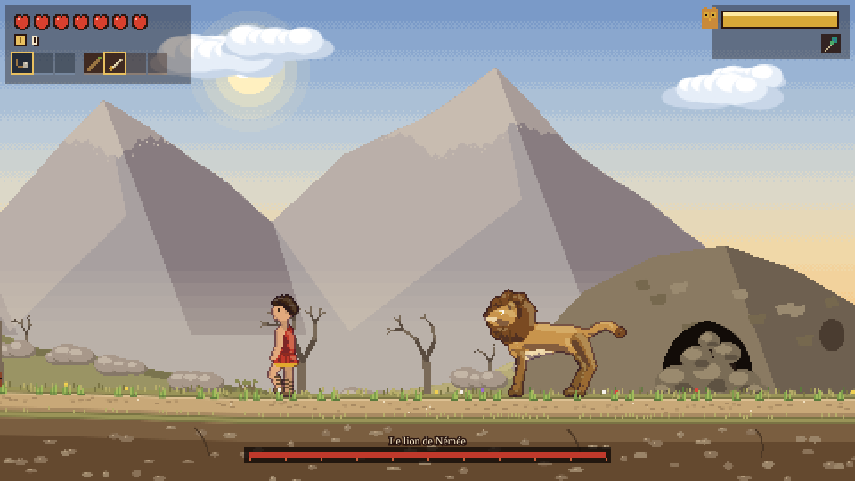
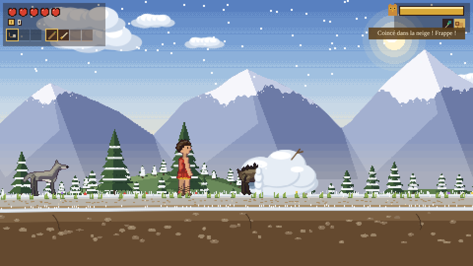
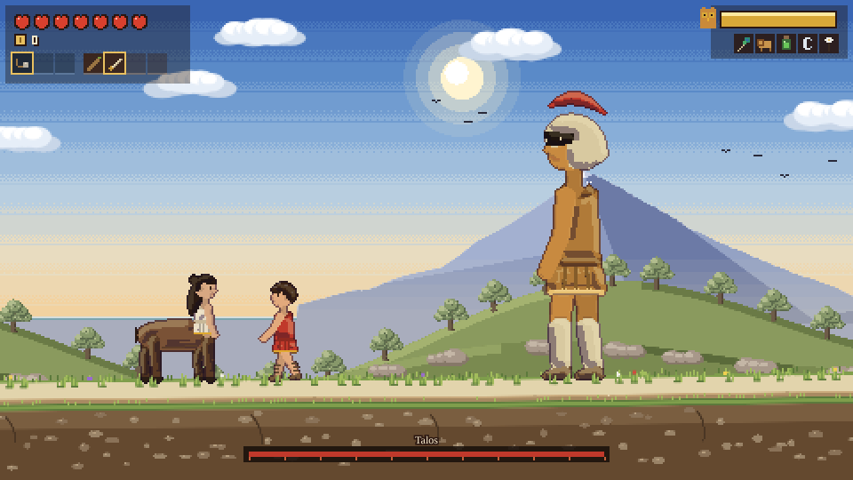

# Perroclès · Περροκλής · Perrocles

*Le fils d'un dieu, au pied de l'Olympe.* A god's son, at the foot of Olympus.



A boy in a village at the foot of Mount Olympus has never been noticed by anyone. Not by
the gods, and hardly by the village either. His mother won't say who his father is. Nobody
will, because everyone who knows has sworn an oath on the Styx. So he goes to find out for
himself, following in the footsteps of Heracles and Odysseus, guided by an old man called
Mentor who is obviously not an old man.

Perroclès is a side-scrolling action adventure in Greek mythology, from the first morning in
the village to the end of the story. It's a single HTML file, like every Maison Perron game:
open it in a browser and play.

**▶ [`perrocles.html`](perrocles.html)** · version 1.3 · French by default, Greek and English one tap away

> **En bref :** un jeune demi-dieu suit les traces d'Héraclès et d'Ulysse pour découvrir
> lequel des dieux est son père. Deux mondes l'un sur l'autre : celui des mortels, en pixel
> art, et le regard des dieux, peint comme un vase grec. Un seul fichier HTML, en français,
> en grec ou en anglais. Se joue au clavier ou à la manette (PlayStation ou Xbox).

## Two sights

The whole game rests on one rule. **Gods can't see mortals, and mortals can't see gods.** To a
god, people are mist. To people, gods are an old beggar, a merchant, a shepherd, nobody in
particular. A demigod can see both worlds, but never both at once.

Early on, Mentor gives the boy the **Owl's Eye**. Press it and the world turns into a painted
Greek vase: black figures on red clay, a meander band for the ground, nothing else. In
the **God's view**:

- ordinary people, animals and monsters become drifting mist, and they can't see you, so you
  can walk past them;
- disguised gods show who they really are, with their names pressed into small clay tablets
  beside them, the way names are painted on real vases;
- some things only exist on the gods' side: hidden paths, divine weapons, a word written on a
  wall, someone who has been standing next to you the whole time.

The Eye runs on ichor, which refills over time. A good part of the game is knowing when to look.

| Mortal view | The same moment in the God's view |
|---|---|
|  |  |

## The story

The game is told in five parts. Each one ends with a painted vase in the Gallery.

| | Part | What happens (no spoilers) |
|---|---|---|
| Prologue | **The boy nobody saw** | Oloosson, in Perrhaebia. His mother Theano at her loom, the village, the first wolves, and a road to Delphi. |
| Act I | **The Labours** | The Argolid road, Tiryns, and King Eurystheus hiding in his bronze jar. The Nemean lion, the Hydra of Lerna, the golden hind, the Erymanthian boar, the Stymphalian birds, the Augean stables. The labour beasts are constellations someone keeps pulling down from the sky. |
| Act II | **The wine-dark sea** | A ship out of Argos. Polyphemus, Aeolus's runaway winds, Circe, the Sirens, Scylla and Charybdis, then Crete: Talos, Ariadne's thread, the Labyrinth and the one who lives in it. |
| Act III | **His own eyes** | A truth on the shore. Lemnos, Atlas and the dragon Ladon, Prometheus and the eagle, and the Underworld, where the dead have sworn nothing at all. |
| Act IV | **The return** | Etna, a monster under the mountain, the Heraion, and Olympus. Then home, a name, and an ending that depends on how you played. |

The father's name is spelled out on the way, one Greek letter at a time, wherever the oath
can't stop it from being written.

## How it plays

- **Fight with what fits.** Two weapon rows: melee (club, bronze xiphos, the later forge-blade)
  and throwing (sling stones, the arc-sling). The Nemean lion's hide turns swords, the Hydra's
  stumps need a torch, the boar has to be tricked into a snowdrift. Every boss is a small
  puzzle before it's a fight.
- **Talk, and choose how you are.** Conversations offer answers in three moods: **Force**,
  **Cunning** and **Heart**. Your first choice in Tiryns sets the order of the labours and of
  the islands at sea, and a choice at the very end decides where the story leaves him.
- **Companions.** Ocyrhoe, a centaur girl cursed to only half-tell the future (she heals you
  when you're low), and later another friend. One walks with you; the others ride on the ship.
- **The Library.** Every god you identify gets a page in the **Book of the Gods**: a marble
  plate that moves a little, their family, what they're known for, the sources, and a quote.
  The **Vase Gallery** fills with one painted vase per part, which you can turn to read the
  story so far.
- **Fair, then hard.** The normal game is tuned so a first-time young player gets through
  every fight, with a little help when a fight drags on (the Hydra grows heads slower, the
  boar's snowdrifts get bigger). **Heroic mode** (title or pause menu) is the real challenge:
  faster bosses, fewer openings, much less mercy.
- **Saves.** The game saves as you go, in your browser only. *Continue* picks up
  where you left off, even mid-act.

### Controls

| | Keyboard | PlayStation | Xbox |
|---|---|---|---|
| Walk | ← → or A D | left stick / d-pad | left stick / d-pad |
| Jump | Space, ↑ or W | ✕ | A |
| Strike | X or J | □ | X |
| Talk, use, pick up | E or ↓ | □ or ↓ | X or ↓ |
| Throw | C or K | △ | Y |
| Next throwing weapon | R | L1 | LB |
| Next melee weapon | Q | R1 | RB |
| The God's view | V | L2 + R2 together (or the touchpad) | LT + RT together |
| The Library | Tab | Create | View |
| Skip a scene | hold Esc | hold ○ | hold B |
| Pause | Esc or P | Options | Menu |
| Language | L | (pause menu) | (pause menu) |

The controls are also listed in the pause menu. A controller rumbles for the big moments (a
boss falling, a reveal, a heartbeat); you can turn it off in the pause menu.

<p>


</p>
<p>


</p>
<p>

</p>

## How it's made

The house rules apply: **one file, no dependencies.** Every sprite, background, vase painting
and close-up is drawn in code on a `<canvas>`. The music (lyre, aulos, frame drums, a
different mode for the God's view) and every sound effect are synthesized live with the Web
Audio API. No images, no sound files, no libraries, no network.

- **Resolution:** a 480 × 270 logical screen with 2-pixel "pixels", scaled up crisp. Story
  close-ups are painted at 8× that density on a separate high-resolution layer, and so are the
  Book of the Gods and the gods' name tablets.
- **Characters:** each body is a small skeleton (hips, knees, two arms, a head that tilts) baked
  into sprites at load time, so steps match the distance walked, crouches bend the knees, and
  the same figure can be drawn as pixel art or as a black-figure silhouette.
- **Scenes** are JavaScript generators (`yield SAY(...)`, `yield WAIT(...)`, `yield* walkTo$(...)`),
  so a cutscene reads like a script.
- **Size:** about 1 MB of HTML, 28 places, 71 characters and creatures, three languages.

### Building from source

The playable file is built from the modules in [`source/`](source):

```sh
cd games/perrocles/source
python3 build.py            # writes ../perrocles.html
```

`build.py` pastes the drawing kit (`kit/`) and the game modules (`src/`, in file-name order)
into `shell.html`. That's all it does: there's no bundler or minifier, and the result is
the game. The modules are numbered by layer: `00`–`32` engine, art and input, `40`–`60`
actors, world, dialogue and story engine, `62`–`6h` the Prologue and the four acts, `70`–`7c`
the God's view, interface, close-ups and the Library, `90` the main loop, `95` the test hook.

### Testing it with bots

[`tools/sim/`](tools/sim) holds the playtesting robot used to balance and harden the game. It
drives the real game in headless Chromium through the `window.GAME` test hook, fast-forwards
time, plays as different kinds of player (a first-time kid, a hardcore player, a button
masher, Heroic mode), adds monkeys that press random keys, and quits and reloads at random
moments. Every frame it checks for softlocks: a scene that never ends, a black screen, a hero
stuck off-screen or below the floor. See [the design notes](docs/DESIGN.md#testing-with-hundreds-of-robot-playthroughs).

```sh
pip install playwright && playwright install chromium
cd games/perrocles/tools/sim
./fz.sh try kid 4 100 2          # 4 full kid playthroughs, seeds 100–103, two at a time
./fz.sh try hardH 2 200 2 1      # 2 Heroic runs by the hardcore bot, with a light monkey
python3 fzr.py '/tmp/fz/try/*.jsonl'   # finished / stuck / deaths / boss times, per run
```

Results and screenshots land in `/tmp/fz/<tag>/` (set `OUT` to change it). `run.py` also takes
`START=lerna`, `act2`, `act3a`, `act4`… to start mid-game, `CHAOS=2` for a heavy monkey and
`RELOAD=0.3` to quit and Continue at random.

## Design notes

How the game came about, what was decided along the way, and why:
**[docs/DESIGN.md](docs/DESIGN.md)**. The raw decision log, written during development and
milestone by milestone, is in [docs/decisions.html](docs/decisions.html).

The whole script, in play order, is in [docs/script/](docs/script) (French, English, Greek).
It gives away everything. `python3 tools/script.py` regenerates it from the source.

## Credits and licence

Made by the Perron household with Claude (Anthropic). The myths are thousands of years old;
the versions here lean on Homer, Hesiod, Pindar, Apollodorus, Ovid and Borges, with
liberties taken and owned up to in the Book of the Gods. Apache 2.0, like the rest of the
repository.
