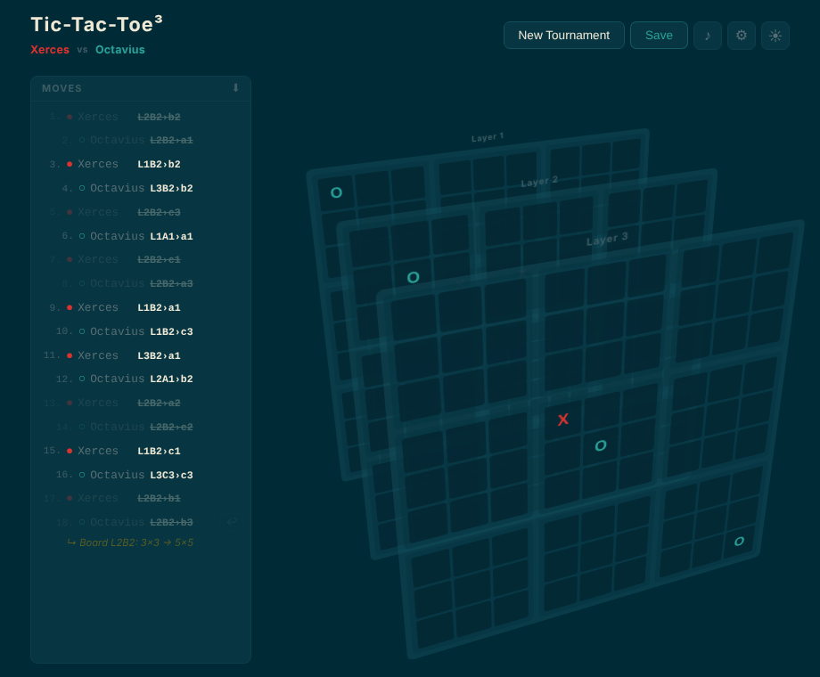
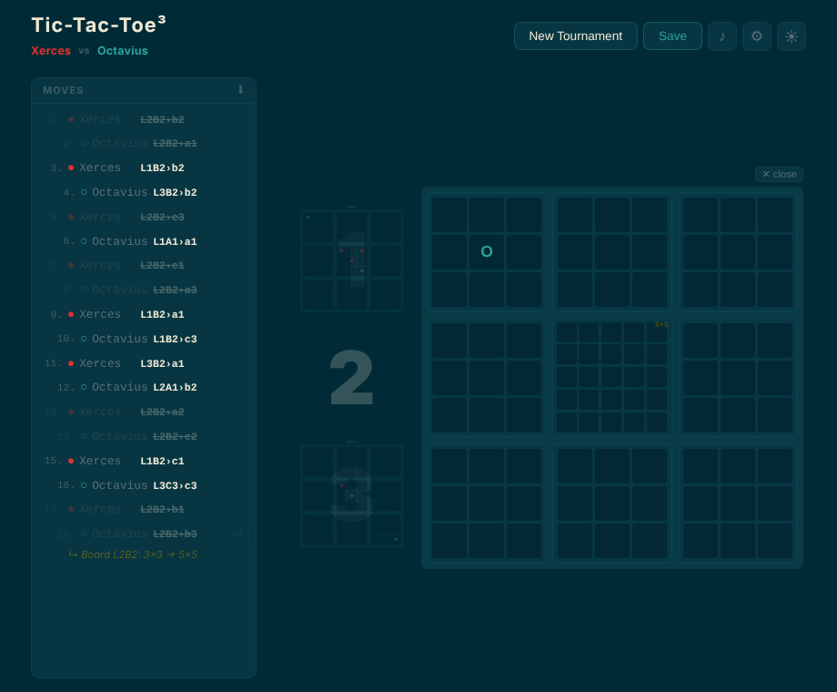

# Tic-Tac-Toe³

Tic-tac-toe, cubed. Twenty-seven small boards stacked into a 3 × 3 × 3 cube, for two
players sharing one screen: **Xerces** (✕, red) against **Octavius** (○, teal).

  

## Play it

Open **`tic-tac-toe-3.html`** in a browser. There's nothing to install and it works offline.
It's laid out for a computer with a mouse (the board is about 830 pixels wide).

## How it works

**The cube.** Three layers, each a 3 × 3 grid of ordinary tic-tac-toe boards: 27 small boards
in all.

**A turn.** Click a layer to bring it forward, then play in any small board that isn't decided
yet. Unlike *Ultimate* tic-tac-toe, your move doesn't send your opponent to a particular board:
you can play anywhere open in any layer.

**Winning a small board.** Three in a row claims it, and its square in the cube becomes yours.

**Winning the game.** Claim three squares in a straight line through the cube. There are
**49 lines**:

| Lines | How many |
|---|---|
| Rows and columns within a layer | 18 |
| Diagonals within a layer | 6 |
| Pillars straight through the three layers | 9 |
| Diagonals that slant through the layers (on the cube's vertical slices) | 12 |
| Corner-to-corner diagonals through the centre of the cube | 4 |

### When a small board is a draw

Choose the rule with the ⚙ button. Changing it mid-game restarts the game.

- **⚔ Sudden Death** (default): the board grows and you keep playing on it. 3 × 3 becomes
  5 × 5 (four in a row to win), then 7 × 7 (five in a row). A drawn 7 × 7 becomes a **wild ★**.
- **★ Both Claim**: the board becomes a **wild ★** right away.
- **☠ Nobody Gets It**: the board becomes **dead ☠**.

A **wild ★** counts for *either* player when completing a line. A **dead ☠** square blocks
every line that passes through it.

## Controls

| To… | Do this |
|---|---|
| Turn the cube | Drag it |
| Zoom into a layer | Click it (the other two shrink to the side; click one to switch) |
| Go back to the cube | ✕ close, Esc, or click outside the board |
| Undo the last move | ↩ next to it in the move list |
| Find a move on the board | Hover it in the move list, or click to jump to it |
| Export the moves | ⬇ at the top of the move list (CSV) |

  

## Around the board

- **Move list with notation.** `L1B2›a1` means layer 1, column B, row 2 of the cube, then
  cell a1 (column a, row 1) of that small board. Moves erased when a board grows are crossed
  out, and each board expansion is logged.
- **Tournaments.** The score strip under the board keeps a running tally. Up to 32 finished
  games are kept in the browser's local storage. Click one to replay its final position
  read-only, or ＋ to start the next game. **New Tournament** clears it all.
- **Save as a link.** **Save** writes the current position (with the last five moves) into the
  page's address and copies it, so a game can be sent to someone else or picked up later.
- **Music.** ♪ opens a small player with eight chiptune tracks synthesized in the browser,
  including arrangements of the *Blue Danube*, the *Nutcracker* and Vivaldi's *Spring*.
- **Light and dark themes** with the ☀ button.

## Notes

- English only for now, and it has no version number yet. The launcher shows its last commit
  instead.
- Its music player is its own small engine, not the one shared by the other Maison Perron
  games.
